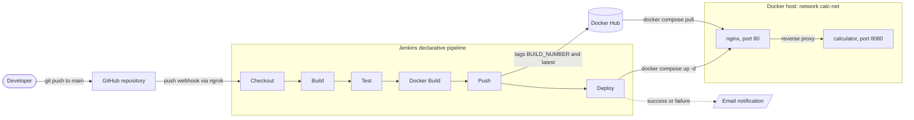
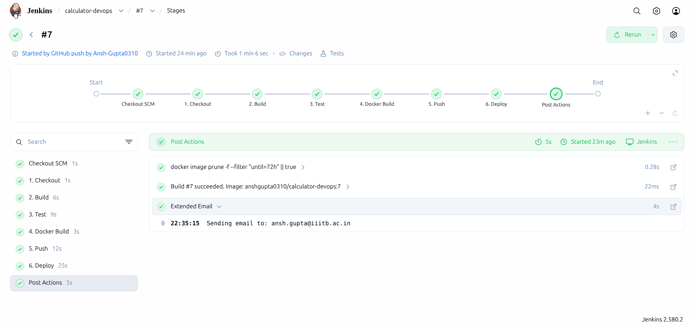
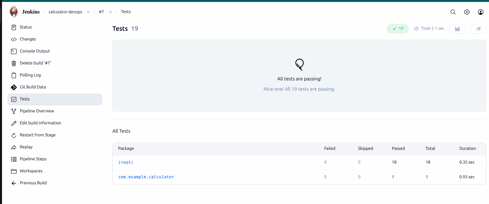
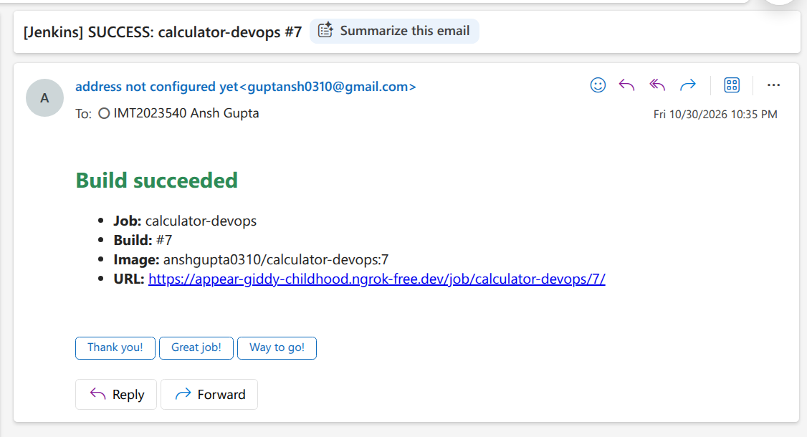
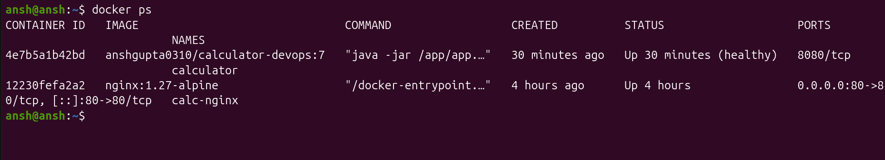
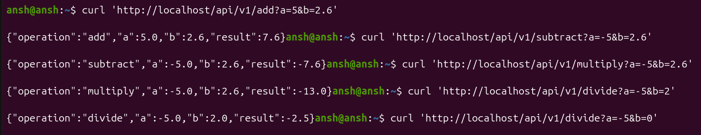
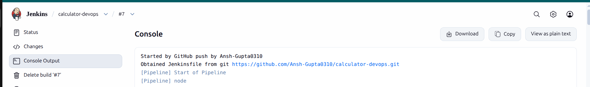

# Calculator DevOps

A Spring Boot Calculator REST API wrapped in a fully automated CI/CD pipeline. A push to `main` on GitHub triggers Jenkins, which builds, tests, containerizes, publishes and deploys the application with Docker Compose, then emails the build result. No manual steps.

Mini-Project for **CSE 816: Software Production Engineering**, iMTech (CSE), Term I, 2026-27, IIIT Bangalore.

| | |
|---|---|
| **Author** | Ansh Gupta (IMT2023540) |
| **GitHub** | https://github.com/Ansh-Gupta0310/calculator-devops |
| **Docker Hub** | https://hub.docker.com/r/anshgupta0310/calculator-devops |
| **Report** | [docs/report.pdf](docs/report.pdf) |

## Contents

1. [Architecture](#architecture)
2. [Tech stack](#tech-stack)
3. [Repository structure](#repository-structure)
4. [API reference](#api-reference)
5. [Prerequisites](#prerequisites)
6. [Build and test](#build-and-test)
7. [Run the application](#run-the-application)
8. [CI/CD pipeline](#cicd-pipeline)
9. [Jenkins setup](#jenkins-setup)
10. [Configuration](#configuration)
11. [Git workflow](#git-workflow)
12. [Screenshots](#screenshots)
13. [Troubleshooting](#troubleshooting)

## Architecture



Only Nginx publishes a port (80) to the host. The calculator container is reachable only inside the `calc-net` bridge network, and Nginx starts only after the calculator's health check reports healthy.

## Tech stack

| Layer | Technology |
|---|---|
| Language | Java 21 (Eclipse Temurin) |
| Framework | Spring Boot 4.1.2: Spring Web MVC, Actuator, Validation |
| Build | Maven 3.9 |
| Tests | JUnit 5, Spring MockMvc, Hamcrest |
| Version control | Git, GitHub (feature branches and pull requests) |
| CI/CD | Jenkins 2.580.2, declarative `Jenkinsfile` |
| Containers | Docker (multi-stage build), Docker Hub |
| Deployment | Docker Compose v2, Nginx 1.27 reverse proxy |
| IDE | IntelliJ IDEA (project generated with Spring Initializr) |

## Repository structure

```
calculator-devops/
|-- src/
|   |-- main/
|   |   |-- java/com/example/calculator/
|   |   |   |-- CalculatorApplication.java        # Spring Boot entry point
|   |   |   |-- controller/CalculatorController.java  # REST endpoints
|   |   |   |-- service/CalculatorService.java    # arithmetic logic
|   |   |   |-- dto/CalculationResponse.java      # success JSON body
|   |   |   |-- dto/ApiError.java                 # error JSON body
|   |   |   `-- exception/
|   |   |       |-- DivideByZeroException.java
|   |   |       `-- GlobalExceptionHandler.java   # maps errors to HTTP 400
|   |   `-- resources/application.properties      # port, Actuator settings
|   `-- test/java/com/example/calculator/
|       |-- CalculatorServiceTest.java            # 10 unit tests
|       |-- CalculatorControllerTest.java         # 8 MockMvc integration tests
|       `-- CalculatorApplicationTests.java       # context-load test
|-- nginx/nginx.conf                              # reverse proxy config
|-- Dockerfile                                    # multi-stage build
|-- .dockerignore
|-- docker-compose.yaml                           # calculator + nginx stack
|-- Jenkinsfile                                   # 6-stage CI/CD pipeline
|-- docs/
|   |-- report.pdf                                # project report
|   `-- screenshots/                              # evidence screenshots
|-- pom.xml
|-- .gitignore
`-- README.md
```

## API reference

All math endpoints accept two numeric query parameters, `a` and `b` (integers or decimals, negatives allowed).

| Operation | Method and path | Behaviour |
|---|---|---|
| Add | `GET /api/v1/add?a=&b=` | returns `a + b` |
| Subtract | `GET /api/v1/subtract?a=&b=` | returns `a - b` |
| Multiply | `GET /api/v1/multiply?a=&b=` | returns `a * b` |
| Divide | `GET /api/v1/divide?a=&b=` | returns `a / b`; `b = 0` gives HTTP 400 |
| Health | `GET /actuator/health` | Spring Actuator probe, `UP` or `DOWN` |

### Successful response (HTTP 200)

```bash
curl 'http://localhost/api/v1/add?a=5&b=2.6'
```
```json
{"operation":"add","a":5.0,"b":2.6,"result":7.6}
```

### Error response (HTTP 400)

Every client error returns the same structured body, produced by `GlobalExceptionHandler`:

```bash
curl -i 'http://localhost/api/v1/divide?a=10&b=0'
```
```json
{
  "timestamp": "2026-10-30T17:05:12.345Z",
  "status": 400,
  "error": "Bad Request",
  "message": "Cannot divide by zero",
  "path": "/api/v1/divide"
}
```

| Case | Example request | `message` field |
|---|---|---|
| Division by zero | `/api/v1/divide?a=10&b=0` | `Cannot divide by zero` |
| Missing parameter | `/api/v1/add?a=2` | `Missing required parameter: 'b'` |
| Non-numeric parameter | `/api/v1/add?a=abc&b=3` | `Invalid value for parameter 'a': must be a number` |
| Unknown path | `/api/v1/square` | HTTP 404 (Spring default) |

### Health check

```bash
curl http://localhost/actuator/health
```
```json
{"status":"UP","components":{ ... },"groups":["liveness","readiness"]}
```

## Prerequisites

| Tool | Version | Check |
|---|---|---|
| JDK | 21 | `java -version` |
| Maven | 3.9 or newer | `mvn -version` |
| Docker Engine | 24 or newer | `docker --version` |
| Docker Compose | v2 plugin | `docker compose version` |
| Git | any recent | `git --version` |
| Jenkins | LTS, for the pipeline only | Jenkins dashboard opens in the browser |

## Build and test

```bash
git clone https://github.com/Ansh-Gupta0310/calculator-devops.git
cd calculator-devops

# Compile and package the executable JAR (tests skipped)
mvn clean package -DskipTests
# Output: target/calculator-devops-0.0.1-SNAPSHOT.jar

# Run all 19 tests (JUnit 5 unit tests + MockMvc integration tests)
mvn test
# JUnit XML reports: target/surefire-reports/TEST-*.xml
```

| Test class | Type | Tests | Covers |
|---|---|---|---|
| `CalculatorServiceTest` | Unit (plain JUnit 5) | 10 | every operation, negatives, decimals, multiply by zero, divide by zero throws |
| `CalculatorControllerTest` | Integration (`@SpringBootTest` + MockMvc) | 8 | all four endpoints, 400 for divide by zero, missing and invalid parameters, 404 for unknown path |
| `CalculatorApplicationTests` | Context load | 1 | Spring application context starts |

## Run the application

### Option 1: directly with Maven (port 8080)

```bash
mvn spring-boot:run
curl 'http://localhost:8080/api/v1/multiply?a=4&b=3'
```

Or run the packaged JAR: `java -jar target/calculator-devops-0.0.1-SNAPSHOT.jar`.

If port 8080 is already taken (for example by Jenkins), add `--server.port=8081` to the `java -jar` command.

### Option 2: single container (port 8080)

```bash
# Build locally
docker build -t anshgupta0310/calculator-devops:local .
docker run --rm -d -p 8080:8080 --name calc anshgupta0310/calculator-devops:local

# Or pull the published image
docker pull anshgupta0310/calculator-devops:latest
docker run --rm -d -p 8080:8080 --name calc anshgupta0310/calculator-devops:latest

curl 'http://localhost:8080/api/v1/subtract?a=5&b=2'
docker stop calc
```

### Option 3: full stack with Docker Compose (port 80)

```bash
docker compose up -d          # starts calculator + nginx
docker compose ps             # calculator should show (healthy)
curl 'http://localhost/api/v1/divide?a=-5&b=2'
docker compose logs -f calculator
docker compose down           # stop and remove the stack
```

To deploy a specific image tag, set `DOCKER_IMAGE`:

```bash
DOCKER_IMAGE=anshgupta0310/calculator-devops:7 docker compose up -d
```

### Dockerfile design

| Practice | How it is applied |
|---|---|
| Multi-stage build | Stage 1 `maven:3.9.9-eclipse-temurin-21` builds the JAR; stage 2 `eclipse-temurin:21-jre-alpine` runs it |
| Only the artifact is shipped | `COPY --from=build` copies just the JAR into the runtime image |
| Minimal base image | Alpine JRE, no JDK, no Maven, no source code |
| Non-root user | `app` user and group created; `USER app` before `ENTRYPOINT` |
| Explicit port | `EXPOSE 8080` |
| Dependency layer caching | `pom.xml` copied and `mvn dependency:go-offline` run before `COPY src`, so code changes reuse the cached dependency layer |
| Small build context | `.dockerignore` excludes `target/`, `.git/`, IDE files and secrets |
| Signal handling | exec-form `ENTRYPOINT`, so Java runs as PID 1 and receives `docker stop` signals |

### Compose design

| Requirement | Implementation |
|---|---|
| Network | user-defined bridge network `calc-net`; Nginx reaches the app by service name `calculator` |
| Health check | `wget -qO- http://localhost:8080/actuator/health` every 15 s, 5 retries, 20 s start period |
| Restart policy | `restart: unless-stopped` on both services |
| Environment variables | `SPRING_PROFILES_ACTIVE`, `JAVA_TOOL_OPTIONS`, and `DOCKER_IMAGE` for the image tag |
| Second component | Nginx reverse proxy in front of the API; `depends_on` with `condition: service_healthy` |
| Single command | `docker compose up -d` launches the whole stack |

## CI/CD pipeline

The pipeline is defined in the [`Jenkinsfile`](Jenkinsfile) at the repository root and runs automatically on every push to `main` through a GitHub webhook.

| # | Stage | What it does | Fails when |
|---|---|---|---|
| 1 | Checkout | `checkout scm` pulls the commit that triggered the build | repository unreachable |
| 2 | Build | `mvn -B -ntp clean package -DskipTests` | compilation error |
| 3 | Test | `mvn -B -ntp test`; JUnit XML published with the `junit` step in `post { always }` | any test fails |
| 4 | Docker Build | `docker build` tagged `:${BUILD_NUMBER}` and `:latest` | Dockerfile error |
| 5 | Push | `docker login --password-stdin` inside `withCredentials`, then push both tags | bad credentials or network error |
| 6 | Deploy | exports `DOCKER_IMAGE`, runs `docker compose pull` and `docker compose up -d --remove-orphans`, then `curl -fsS http://localhost/actuator/health` | stack does not come up healthy |

**Post actions:** an HTML email (Email Extension plugin) is sent on success and on failure, and `docker image prune` removes images older than 72 hours.

**Pipeline options:** `timestamps()`, a 20 minute `timeout`, and `buildDiscarder` keeping the last 15 builds.

**Security:** the Docker Hub login comes from the Jenkins Credentials store (ID `dockerhub-creds`). No username, password or token is written in the repository; Jenkins masks the bound values in the console log.

**Idempotent re-runs:** `docker compose up -d` recreates only services whose image or configuration changed. A re-run with a new image tag replaces the calculator container and leaves the Nginx container running, so the deployment is never torn down. Every build pushes a unique `:${BUILD_NUMBER}` tag, so builds never overwrite each other's images.

## Jenkins setup

1. **Plugins:** Pipeline, Git, GitHub Integration, Credentials Binding, JUnit, Email Extension.
2. **Docker access:** the user that runs Jenkins must be able to run `docker` (for a native install: `sudo usermod -aG docker jenkins`, then restart Jenkins).
3. **Docker Hub credential:** Manage Jenkins, Credentials, Global, Add Credentials. Kind: *Username with password*. Username: Docker Hub username. Password: a Docker Hub personal access token with Read and Write scope. ID: `dockerhub-creds`.
4. **Email:** Manage Jenkins, System, Extended E-mail Notification. SMTP server `smtp.gmail.com`, port `465`, SSL enabled, credentials using a Gmail app password, content type HTML.
5. **Pipeline job:** New Item, *Pipeline*. Definition: *Pipeline script from SCM*. SCM: Git, repository URL of this repo, branch `*/main`, script path `Jenkinsfile`. Build trigger: *GitHub hook trigger for GITScm polling*.
6. **Webhook:** expose Jenkins with `ngrok http <jenkins-port>` and set *Jenkins URL* (Manage Jenkins, System) to the public HTTPS URL. In GitHub: Settings, Webhooks, Add webhook. Payload URL `https://<public-jenkins-url>/github-webhook/` (trailing slash required), content type `application/json`, event *Just the push event*.

## Configuration

| Variable | Where | Default | Purpose |
|---|---|---|---|
| `DOCKER_IMAGE` | shell, `.env`, or Jenkins | `anshgupta0310/calculator-devops:latest` | image tag that Compose deploys |
| `SPRING_PROFILES_ACTIVE` | `docker-compose.yaml` | `prod` | active Spring profile |
| `JAVA_TOOL_OPTIONS` | `docker-compose.yaml` | `-Xms128m -Xmx384m` | JVM heap limits, read by the JVM automatically |

Application settings in `src/main/resources/application.properties`:

| Property | Value |
|---|---|
| `server.port` | `8080` |
| `management.endpoints.web.exposure.include` | `health,info` |
| `management.endpoint.health.show-details` | `always` |
| `management.endpoint.health.probes.enabled` | `true` (adds liveness and readiness groups) |

## Git workflow

Work was done on short-lived feature branches and merged into `main` through pull requests:

| PR | Branch | Contents |
|---|---|---|
| #1 | `feat/calculator-endpoints` | service, DTOs, controller, global exception handler, tests |
| #2 | `feat/dockerfile` | multi-stage Dockerfile and `.dockerignore` |
| #3 | `feat/docker-compose` | Compose stack with Nginx reverse proxy and health check |
| #4 | `ci/jenkinsfile` | 6-stage declarative pipeline with Docker Hub push |
| #5 | `ci/email-notify` | email notifications in the pipeline `post` block |

Commit messages follow the Conventional Commits style (`feat:`, `test:`, `build:`, `ci:`, `docs:`). The `.gitignore` excludes `target/`, IDE files, logs and secret files (`.env`, `*.pem`, `*.key`).

## Screenshots

| | |
|---|---|
| Green pipeline run (build #7, triggered by GitHub push) |  |
| JUnit results published in Jenkins (19 passing) |  |
| Email notification |  |
| Running containers |  |
| Sample API responses through Nginx |  |
| Build started by GitHub push |  |

## Troubleshooting

| Symptom | Likely cause and fix |
|---|---|
| Push does not start a build | check GitHub, Settings, Webhooks, Recent Deliveries; the ngrok tunnel must be running and the payload URL must end in `/github-webhook/` |
| `docker: permission denied` in Jenkins | the Jenkins user is not in the `docker` group |
| `denied: requested access to the resource is denied` on push | credential ID is not `dockerhub-creds`, or the token lacks Write scope |
| Deploy stage `curl` fails | Spring Boot still starting, or port 80 already in use; check `docker compose logs calculator` |
| No email arrives | test SMTP in Jenkins system settings; Gmail requires an app password; check the spam folder |

## Future work

This project is the base for the semester Capstone, which extends the same pipeline with Ansible for configuration management, Kubernetes for orchestration, and Prometheus with Grafana for monitoring.